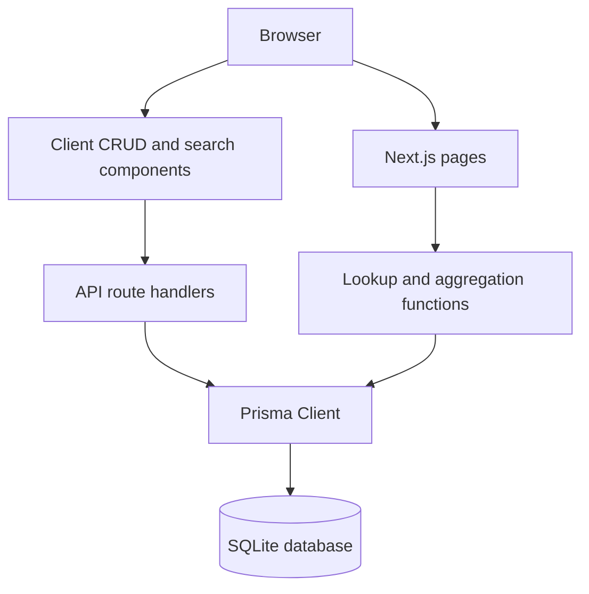
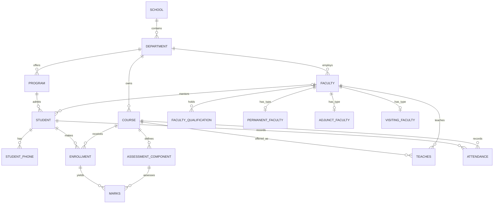
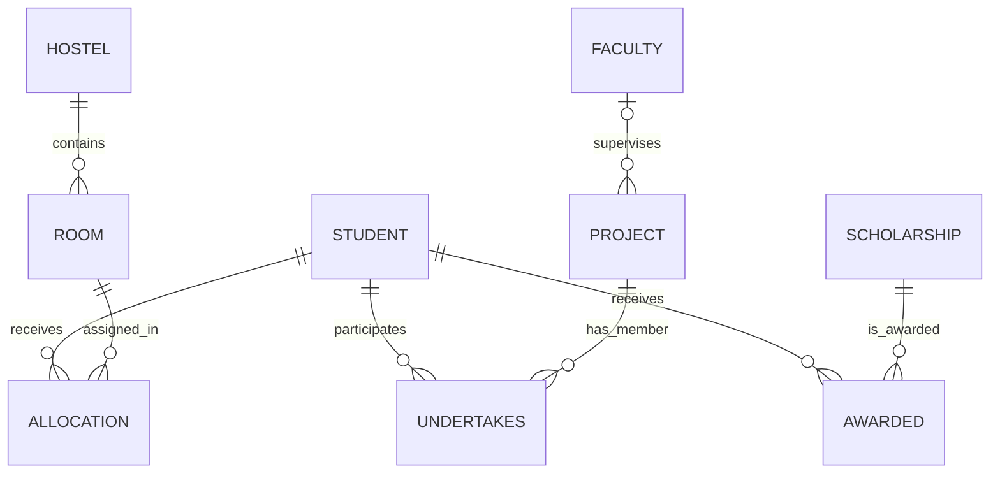

# ABC University - Integrated Academic Management

A full-stack Database Management Systems project for ABC University. It models academic structure, people, teaching, assessment, scholarships, accommodation, and research in a normalized SQLite database. The Next.js application supplies generic CRUD screens, search, detailed entity views, and JSON APIs.

> The database has **23 relations**. The schema and migration are the source of truth; the web UI provides a practical way to explore and operate on them.

## Contents

- [Overview](#overview)
- [Quick start](#quick-start)
- [Architecture](#architecture)
- [Relationship map and graphs](#relationship-map-and-graphs)
- [Entity relationship diagrams](#entity-relationship-diagrams)
- [Complete table reference](#complete-table-reference)
- [Integrity rules](#integrity-rules)
- [Application and API guide](#application-and-api-guide)
- [Data, files, and development](#data-files-and-development)
- [Troubleshooting](#troubleshooting)

---

## Overview

### Functional scope

| Domain | What it manages |
| --- | --- |
| Academic organization | Schools, departments, programs, and courses |
| People | Students, faculty, qualifications, and employment subtypes |
| Teaching | Course offerings, instructors, and enrollments |
| Assessment | Components, marks, grades, and attendance |
| Student support | Scholarships and awards |
| Accommodation | Hostels, rooms, and allocations |
| Research | Projects, supervisors, and student roles |

### Technology

| Layer | Technology | Purpose |
| --- | --- | --- |
| Web framework | Next.js 15 App Router | Pages and backend route handlers |
| UI | React 19 | Interactive search and CRUD interface |
| ORM | Prisma 6 | Database access and model mapping |
| Database | SQLite | Local relational database at `prisma/dev.db` |
| Runtime | Node.js | Development server, migration, and seed execution |

### User capabilities

- Browse all 23 database relations.
- Create, update, and delete rows using a metadata-driven CRUD UI.
- Search students, faculty, and courses by ID, name, and supported email fields.
- Follow relationships from student, faculty, and course detail pages.
- Choose valid values from foreign-key dropdowns where a single-column lookup is possible.
- Receive readable errors for duplicate keys, missing rows, and foreign-key violations.

---

## Quick start

### Prerequisites

Install a current Node.js LTS release. Node.js 18.18+ is a sensible baseline for Next.js 15 and Prisma 6.

### Install and run

```sh
npm install
```

Create `.env` in the project root:

```env
DATABASE_URL="file:./prisma/dev.db"
```

Create the schema and sample data:

```sh
npm run db:init
```

Start the development server:

```sh
npm run dev
```

Open `http://localhost:3000`.

### Commands

| Command | Description |
| --- | --- |
| `npm run dev` | Start the development server |
| `npm run build` | Create a production build |
| `npm run start` | Start the production server after building |
| `npm run db:init` | Deploy migrations and seed sample data |
| `npm run db:seed` | Run only the seed script |
| `npm run db:reset` | Delete local data, reapply migrations, and reseed |
| `npm run db:studio` | Open Prisma Studio |
| `npx prisma generate` | Regenerate Prisma Client |

> `db:reset` destroys the current local data. Use it only for disposable development data.

---

## Architecture



- Server-rendered student, faculty, and course pages call `lib/lookup.js` directly.
- The generic table page calls `/api/tables/[name]` for list, insert, update, and delete operations.
- `lib/tables.js` centralizes relation names, columns, primary keys, and UI foreign-key references.
- Prisma maps JavaScript-style fields such as `studentId` to database columns such as `Student_ID`.
- `prisma/migrations/0_init/migration.sql` contains the actual SQLite DDL, including checks not expressible in Prisma schema syntax.

---


---

## Entity relationship diagrams

### Academic, people, teaching, and assessment



### Scholarships, accommodation, and projects



---

## Complete table reference

### Organization

| Table | Primary key | Purpose | Foreign keys |
| --- | --- | --- | --- |
| `SCHOOL` | `School_ID` | Top-level academic unit and location | None |
| `DEPARTMENT` | `Dept_ID` | Department belonging to a school | `School_ID -> SCHOOL` |
| `PROGRAM` | `Program_ID` | Program level and duration | `Dept_ID -> DEPARTMENT` |
| `COURSE` | `Course_ID` | Course owned by a department | `Dept_ID -> DEPARTMENT` |

### People and specialization

| Table | Primary key | Purpose | Foreign keys |
| --- | --- | --- | --- |
| `FACULTY` | `Faculty_ID` | Shared faculty identity, contact data, type, department | `Dept_ID -> DEPARTMENT` |
| `STUDENT` | `Student_ID` | Student identity, program, optional mentor | `Program_ID -> PROGRAM`; `Mentor_Faculty_ID -> FACULTY` |
| `STUDENT_PHONE` | `(Student_ID, Phone)` | Multivalued student phones | `Student_ID -> STUDENT` |
| `FACULTY_QUALIFICATION` | `(Faculty_ID, Qualification)` | Multivalued qualifications | `Faculty_ID -> FACULTY` |
| `PERMANENT_FACULTY` | `Faculty_ID` | Salary, PF number, confirmation date | `Faculty_ID -> FACULTY` |
| `ADJUNCT_FACULTY` | `Faculty_ID` | Hourly rate and contract end date | `Faculty_ID -> FACULTY` |
| `VISITING_FACULTY` | `Faculty_ID` | Home institution and visit duration | `Faculty_ID -> FACULTY` |

### Teaching and assessment

| Table | Primary key | Purpose | Foreign keys |
| --- | --- | --- | --- |
| `ASSESSMENT_COMPONENT` | `(Course_ID, Component_No)` | Defines a course assessment part | `Course_ID -> COURSE` |
| `ENROLLMENT` | `(Student_ID, Course_ID, Year, Semester)` | Student registration in a course offering | `Student_ID -> STUDENT`; `Course_ID -> COURSE` |
| `ATTENDANCE` | `Attendance_ID` | Daily student-course attendance state | `Student_ID -> STUDENT`; `Course_ID -> COURSE` |
| `MARKS` | `(Student_ID, Course_ID, Year, Semester, Component_No)` | Score for a component in an enrollment | Composite FK to `ENROLLMENT`; composite FK to `ASSESSMENT_COMPONENT` |
| `TEACHES` | `(Course_ID, Year, Semester)` | Faculty assignment for a course offering | `Course_ID -> COURSE`; `Faculty_ID -> FACULTY` |

### Support, housing, and research

| Table | Primary key | Purpose | Foreign keys |
| --- | --- | --- | --- |
| `SCHOLARSHIP` | `Scholarship_ID` | Scholarship definition and eligibility | None |
| `AWARDED` | `(Student_ID, Scholarship_ID, Year)` | Scholarship granted to a student | `Student_ID -> STUDENT`; `Scholarship_ID -> SCHOLARSHIP` |
| `HOSTEL` | `Hostel_ID` | Hostel/building and capacity | None |
| `ROOM` | `(Hostel_ID, Room_No)` | Room inside a hostel | `Hostel_ID -> HOSTEL` |
| `ALLOCATION` | `(Student_ID, Hostel_ID, Room_No, Alloc_Date)` | Student room allocation period | `Student_ID -> STUDENT`; composite FK to `ROOM` |
| `PROJECT` | `Project_ID` | Research project and optional supervisor | `Faculty_ID -> FACULTY` |
| `UNDERTAKES` | `(Student_ID, Project_ID)` | Student role in a project | `Student_ID -> STUDENT`; `Project_ID -> PROJECT` |

---

## Integrity rules

### Key concepts

| Concept | Meaning in this database |
| --- | --- |
| Primary key | Uniquely identifies a row, for example `Student_ID` |
| Composite primary key | Multiple values identify one row, for example one enrollment is student + course + year + semester |
| Foreign key | Requires an existing record in a related table |
| Unique key | Must be unique without being the primary key, for example student and faculty email |
| Junction table | Represents a relationship that may have attributes, such as `ENROLLMENT` and `UNDERTAKES` |

### Referential integrity

SQLite prevents references to missing parent records. Examples:

- A student must reference a real program and, when present, a real mentor.
- An enrollment must reference a real student and course.
- A marks row requires both a valid enrollment and a valid assessment component.
- An allocation must reference both a real student and a real composite room identity.

The generic API translates common Prisma errors into friendly messages:

| Condition | Message |
| --- | --- |
| Duplicate primary or unique key | `Unique constraint failed (duplicate key).` |
| Missing foreign-key target | `Foreign key violation: referenced row does not exist.` |
| Missing update/delete target | `Row not found.` |

### Domain constraints

The SQL migration also enforces these business rules:

- Program level is `UG`, `PG`, or `Doctoral`; duration is positive.
- Faculty type is `Permanent`, `Adjunct`, or `Visiting`.
- Course credits are positive and type is `Core` or `Elective`.
- Assessment maximum marks are positive and weightage is greater than zero and at most 100.
- Semester is 1 or 2 where defined.
- Attendance is either `Present` or `Absent`.
- Marks cannot be negative.
- Scholarship amount, hostel capacity, and room capacity are positive.
- A vacate date cannot precede an allocation date.
- A project end date cannot precede its start date.

### Delete behavior

Most parent records cannot be deleted while referenced. Explicit exceptions are:

| Parent record deleted | Result |
| --- | --- |
| `COURSE` | Related assessment components cascade-delete |
| `HOSTEL` | Related rooms cascade-delete |
| `FACULTY` used as a project supervisor | `PROJECT.Faculty_ID` becomes null |

---

## Application and API guide

### Pages

| Route | Behavior |
| --- | --- |
| `/` | Search interface and 23-table navigation grid |
| `/tables/[name]` | Generic insert, inline update, and delete interface |
| `/students/[id]` | Identity, hierarchy, mentor, marks, attendance, awards, room, and projects |
| `/faculty/[id]` | Department, subtype data, qualifications, teaching, mentees, and projects |
| `/courses/[id]` | Components, instructor, enrollment list, mark statistics, attendance |

The generic table page loads up to 500 primary-key-ordered records. Primary-key columns cannot be edited after insertion; delete and reinsert if a key must change. Empty form values are converted to `NULL`; the database then decides whether null is valid. Dates use `YYYY-MM-DD` text values.

### Computed values

`lib/lookup.js` computes values instead of storing redundant columns:

- Student average mark.
- Student attendance percentage and per-course attendance.
- Completed course count: enrollment has a non-null grade other than `F`.
- Course mark count, average, minimum, and maximum.
- Course present-attendance count.

### API endpoints

| Endpoint | Method | Description |
| --- | --- | --- |
| `/api/search?q=&scope=` | GET | Search students, faculty, and/or courses |
| `/api/detail/student/:id` | GET | Full student detail JSON |
| `/api/detail/faculty/:id` | GET | Full faculty detail JSON |
| `/api/detail/course/:id` | GET | Full course detail JSON |
| `/api/options?table=X` | GET | Up to 500 dropdown options for a table |
| `/api/tables/:name` | GET | Metadata and up to 500 rows |
| `/api/tables/:name` | POST | Insert a full row using database column names |
| `/api/tables/:name` | PUT | Update non-key columns using `{ key, row }` |
| `/api/tables/:name` | DELETE | Delete using all primary-key query parameters |

`/api/tables/:name` expects exact uppercase table names such as `STUDENT`, `ENROLLMENT`, or `PROJECT`. Responses use database column names such as `Student_ID`, not Prisma names such as `studentId`.

For a composite primary key, supply every component when deleting. For example:

```text
DELETE /api/tables/ENROLLMENT?Student_ID=1001&Course_ID=401&Year=2025&Semester=1
```

---

## Data, files, and development

### Seed data

`scripts/seed.js` creates representative connected data:

- 5 schools, departments, programs, faculty members, students, courses, scholarships, hostels, projects, and relationship records.
- 2 permanent, 2 adjunct, and 1 visiting faculty subtype records.
- Enrollment, attendance, marks, and teaching records for 2025 semester 1.
- Student phones, qualifications, room allocations, scholarship awards, and project roles.

The seed is idempotent: it checks whether `SCHOOL` already contains data and skips insertion if so.

### File guide

```text
app/                         Next.js pages and API route handlers
components/SearchBox.js      Client-side scoped search
lib/tables.js                Generic CRUD metadata and FK references
lib/lookup.js                Search, detail queries, and aggregations
lib/prisma.js                Reusable Prisma client
prisma/schema.prisma         Prisma model definitions and database mappings
prisma/migrations/           SQLite DDL, checks, and referential actions
scripts/seed.js              Sample-data seed script
```
---

## Troubleshooting

| Symptom | Resolution |
| --- | --- |
| Database API returns an initialization hint | Confirm `.env` exists, then run `npm run db:init` |
| Prisma client is missing | Run `npx prisma generate` |
| Seed says data already exists | This is intentional; use `npm run db:reset` for fresh local data |
| Delete fails | Remove dependent records first unless a documented cascade or set-null action applies |
| Foreign-key dropdown lacks a value | Create the referenced parent record first |
| Insert reports a foreign-key violation | Verify all referenced key values, including composite-key components |
| Date validation behaves unexpectedly | Use `YYYY-MM-DD` format |
| Build is stale or missing | Run `npm run build` before `npm run start` |

## Verification

```sh
npm run db:init
npm run build
```

After initialization, visit `/`, search for `Aarav`, open `/students/1001`, `/faculty/301`, and `/courses/401`, then inspect a generic relation at `/tables/ENROLLMENT`.
